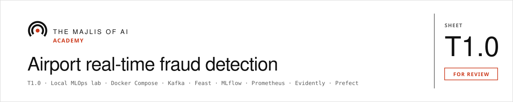

# Airport Real-Time Fraud Detection — Local MLOps Lab

A hands-on class that builds a **production-style, real-time fraud detection system for card
payments at airports**, running entirely on your laptop with **Docker Compose** (no Kubernetes).

Based on [Mayurji/MLOps-Project · real-time-fraud-detection](https://github.com/Mayurji/MLOps-Project/tree/main/real-time-fraud-detection)
and its video walkthroughs ([pipeline](https://www.youtube.com/watch?v=7e5bHzC38WU&t=311s),
[monitoring](https://www.youtube.com/watch?v=F4GcwkTk6JY&t=623s)). This lab adds an airport use case, DVC, a Feast
point-in-time join for training, a model-registry quality gate, and a full monitoring stack.

## What you will learn

- How real-time fraud detection systems work
- Streaming transactions using **Apache Kafka**
- Versioning data with **DVC** and serving features with **Feast** (parquet offline store + Redis online store)
- Tracking and managing ML models with **MLflow** (experiments, registry, `@champion` alias)
- Deploying scalable inference services with **Docker Compose** (and how it maps to Kubernetes)
- Building an end-to-end streaming ML pipeline
- Designing production-ready MLOps architecture
- Setting up **Prometheus** for infrastructure metrics
- Visualizing metrics using **Grafana** dashboards
- Monitoring ML models using **Evidently**
- Detecting data drift and model performance issues
- Building a complete monitoring stack for ML systems
- Automating the pipeline with **Prefect**: run each stage from a UI, retrain nightly and when drift is detected (**Alertmanager**)

## The use case

Passengers pay at airport merchants: airline tickets, duty free, currency exchange, lounges, food,
car rental and electronics, at 10 airports (LIS, OPO, MAD, BCN, LHR, CDG, FRA, AMS, DXB, JFK).
Fraudsters using stolen cards behave differently. They make **large card-not-present purchases at
currency exchange or electronics stores**, often **at night**, **minutes before departure**, in an
airport **far from home**. We must score every payment **in real time**.

| Signal | Source |
|---|---|
| amount, merchant, airport, hour, card present, minutes to departure, international | the payment event (Kafka) |
| 30-day average spend, payments in 7 days, distinct airports in 30 days, account age | passenger profile (**Feast**) |
| amount ÷ 30-day average | derived, the same code at train and serve time (`src/fraud/features.py`) |

---

## Prerequisites

- Docker Desktop (≥ 8 GB RAM assigned), `make`
- [uv](https://docs.astral.sh/uv/) (all Python in this repo runs through uv, both in the containers and on the host)
- Optional: `jq` for pretty JSON

## Project layout

```
├── docker-compose.yml          # Step 3 - the whole platform
├── docker/                     # uv-based Dockerfiles (app image + MLflow server)
├── pyproject.toml / uv.lock    # Python deps, locked with uv
├── params.yaml                 # data / train / publish settings (tracked by DVC)
├── dvc.yaml / dvc.lock         # Step 4 - data pipeline (generate -> features)
├── feature_repo/               # Step 4 - Feast definitions (entity, feature view, feature service)
├── src/fraud/
│   ├── simulation.py           # airport passengers + payments (batch and live)
│   ├── features.py             # feature contract shared by training and serving
│   ├── data/                   # DVC stages: generate.py, build_features.py
│   ├── training/               # Step 5 train.py · Step 6 publish.py
│   ├── serving/api.py          # Step 7 FastAPI
│   ├── streaming/              # Step 8 producer.py, consumer.py
│   ├── monitoring/drift.py     # Evidently -> Prometheus
│   ├── orchestration/flows.py  # Step 9 Prefect flows (one per stage + retrain pipeline)
│   └── console/                # Step 9 live lab console (architecture view + Run buttons)
├── monitoring/                 # Prometheus (+ alert rules), Alertmanager, Grafana dashboard
├── brand/                      # majlisofai (default) · aurora: diagram palette, docs CSS, Mermaid theme, logo
├── scripts/                    # predict.sh · build_docs.py · fetch_fonts.py · export_drawio.sh
└── docs/
    ├── 01-architecture.md      # Step 1 (Mermaid)  · 02-workflow.md  Step 2 (Mermaid)
    ├── diagrams/               # ArchiMate views (.drawio + .png) and the generator scripts
    └── images/                 # tutorial diagrams (.drawio + .png, in the default brand)
```

---

## Step 1 — High-level architecture

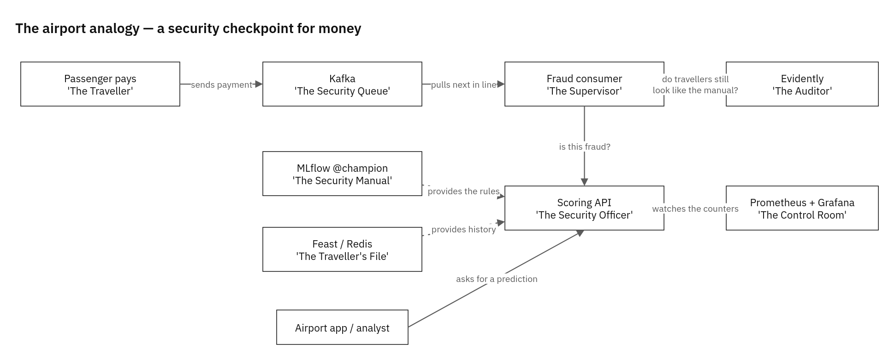
*The airport analogy: each component plays a role at a security checkpoint for money.*

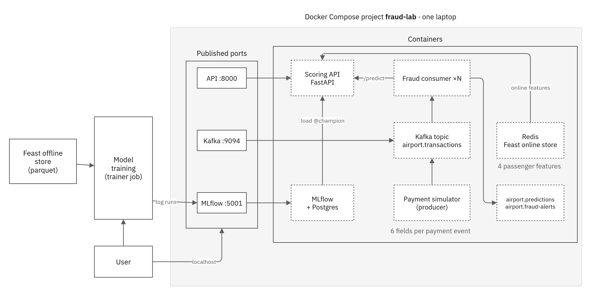
*Lab architecture: the whole lab runs as containers in one Docker Compose project, and only a few ports are published to your laptop.*

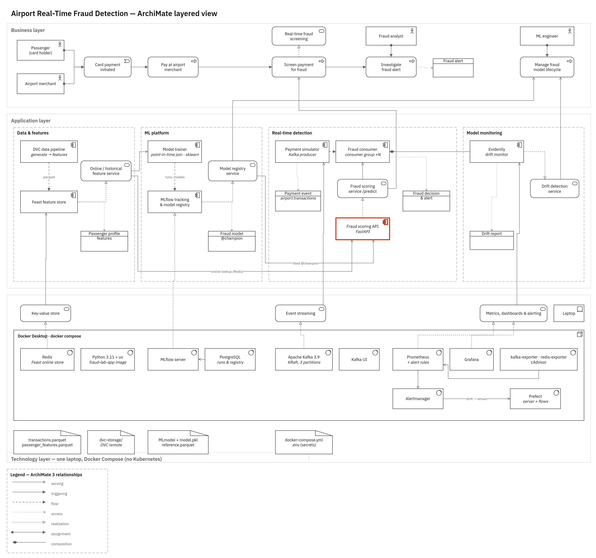
*ArchiMate layered view: business processes served by application services, running on Docker technology.*

[docs/01-architecture.md](docs/01-architecture.md) has the diagram, the role of each component, the airport analogy, and the Compose ↔ Kubernetes mapping.

## Step 2 — Workflow: ingestion → training → serving → monitoring

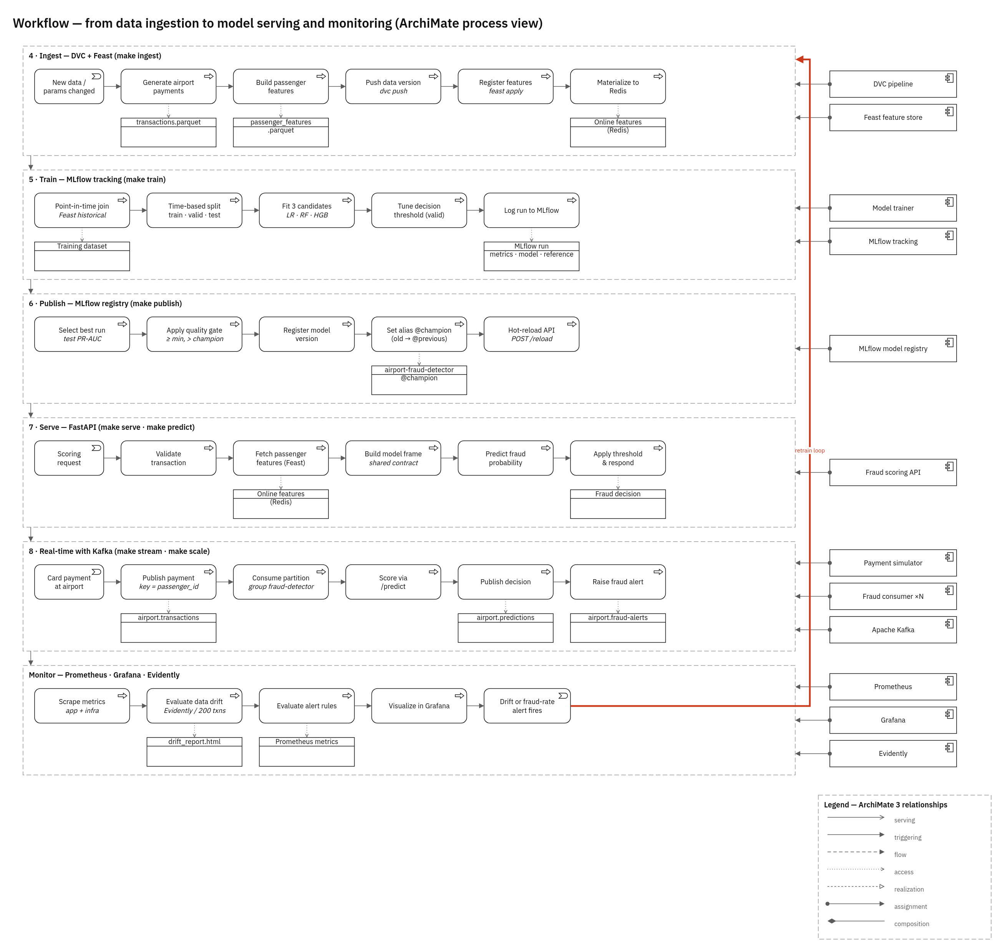
*ArchiMate workflow view: every stage from ingestion to monitoring, the data each one produces, and the retrain loop.*

[docs/02-workflow.md](docs/02-workflow.md) has the end-to-end flow, the path of a single payment (sequence diagram), and the model lifecycle.

## Step 3 — Infrastructure (Dockerfiles + Docker Compose)

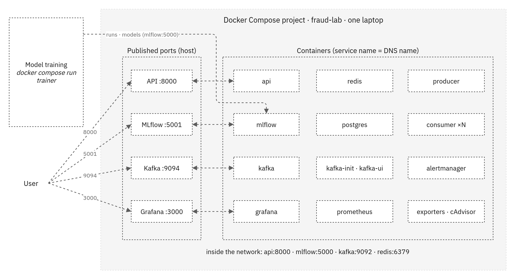
*Docker Compose: published host ports vs. internal service DNS names. The trainer runs as an on-demand job.*

Secrets (Postgres and Grafana credentials) live in **`.env`**, which is git-ignored. On first run, `make`
creates it from `.env.example` with random passwords. Compose refuses to start if a value is missing.
Redis and Kafka run without authentication, because this is a local lab.

```bash
make build      # builds fraud-lab-app (uv sync from uv.lock) and fraud-lab-mlflow
make up         # Kafka (+topics, UI), Redis, Postgres, MLflow, Prometheus, Grafana, exporters
```

| UI | URL |
|---|---|
| Kafka UI | http://localhost:8080 |
| MLflow | http://localhost:5001 |
| Prometheus | http://localhost:9090 |
| Grafana | http://localhost:3000 (anonymous viewer, or log in as admin with the credentials in `.env`) |
| Fraud API docs (after step 7) | http://localhost:8000/docs |

**Discuss:**
- Why do we use one app image with several roles (trainer, api, producer, consumer)?
- What do Compose profiles do? (`jobs`, `serve`, `stream`)
- Why do the Kafka topics have 3 partitions?
- Why does the MLflow server act as an artifact proxy (`--serve-artifacts`)?

## Step 4 — Ingest the data (DVC + Feast)

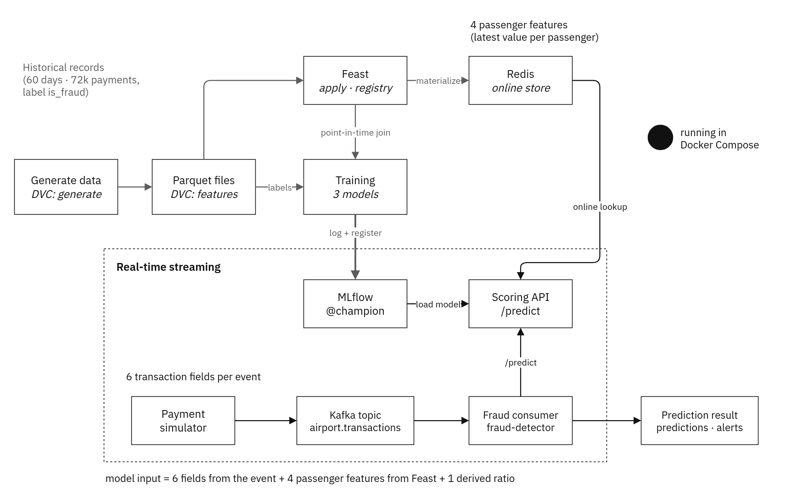
*DVC + Feast: parquet history feeds Feast, giving point-in-time joins for training and Redis for real-time lookups.*

```bash
make ingest
```

This runs, inside the `trainer` container:

1. `dvc repro` runs the pipeline in `dvc.yaml`:
   - `generate` writes 60 days of airport payments to `data/raw/transactions.parquet`
   - `features` writes daily passenger snapshots to `feature_repo/data/passenger_features.parquet`, and labelled events to `data/processed/training_events.parquet`
2. `dvc push` copies the parquet files to the DVC remote (`dvc-storage/`, which stands in for S3/GCS).
3. `feast apply` registers the `passenger` entity, the `passenger_profile` feature view and the `fraud_model_v1` feature service.
4. `feast materialize` loads the latest snapshot per passenger from parquet into **Redis**.

Then commit the data version: `git add dvc.lock && git commit -m "data v1"`.

**Try:** change `data.txn_per_day` in `params.yaml`, then run `make ingest` again. DVC re-runs
both stages. Run it a second time without changes and DVC skips everything.
`docker compose run --rm trainer uv run dvc dag` shows the pipeline.

## Step 5 — Train the model (MLflow)

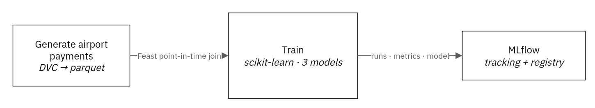
*Training: generated airport payments go to three scikit-learn candidates, all tracked in MLflow.*

```bash
make train
```

- Builds the training set with `store.get_historical_features(...)`, a **point-in-time join**, so each
  payment only sees the passenger profile known *before* that payment (no data leakage).
- Splits the data by time into train, validation and test sets. It trains **logistic regression,
  random forest and gradient boosting**.
- Logs to MLflow: params, test ROC-AUC / PR-AUC / precision / recall / F1, the **decision threshold**
  (tuned on the validation set), a confusion matrix, the model with its signature, the input dataset,
  `data_version` (from `dvc.lock`) and `git_commit`, plus a **reference sample** for Evidently.

Open MLflow → experiment *airport-fraud-detection*, select the 3 runs and click **Compare**.

> Why PR-AUC rather than accuracy? Fraud is about 3% of payments. A model that always says "legit" is 97% accurate and useless.

## Step 6 — Publish the model (MLflow Model Registry)

```bash
make publish
```

- Picks the best run by `test_pr_auc`.
- **Quality gate:** the run must reach `publish.min_metric` and beat the current champion.
- Registers a new version of `airport-fraud-detector`, sets the alias **`@champion`**, and moves the old champion to **`@previous`** (so rollback is one click).
- Calls `POST /reload` on the API, which hot-swaps the model with no downtime.

## Step 7 — Serve the model (FastAPI)

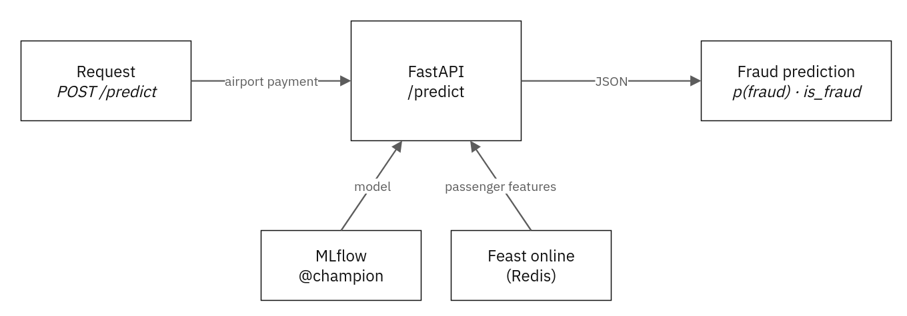
*Serving: FastAPI /predict combines the request with Feast passenger features and the MLflow @champion model.*

```bash
make serve      # starts the api container, which loads models:/airport-fraud-detector@champion
make predict    # one legit and one suspicious payment
```

```bash
curl -s -X POST localhost:8000/predict -H 'Content-Type: application/json' -d '{
  "passenger_id": 42, "airport": "DXB", "merchant_category": "currency_exchange",
  "amount": 2400, "hour_of_day": 3, "is_international": 1, "card_present": 0,
  "minutes_to_departure": 20 }'
```

The response includes `fraud_probability`, `is_fraud`, `model_version`, and the **features the
model actually saw**, including the Feast values fetched from Redis.
Other endpoints: `GET /model`, `GET /health`, `POST /reload`, `GET /metrics`.

## Step 8 — Real-time fraud detection with Kafka

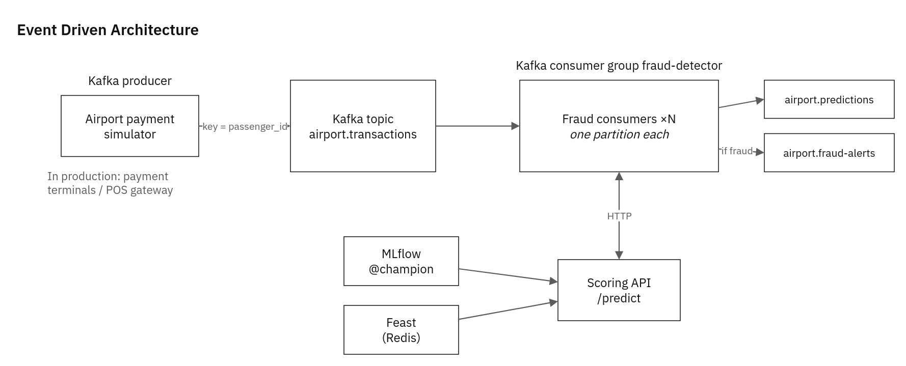
*Event-driven scoring: payments are keyed by passenger, and the consumer group scores them and publishes predictions and alerts.*

```bash
make stream     # producer (airport terminals) + consumer (fraud detector)
make logs       # watch payments and fraud alerts flow
make alerts     # read the airport.fraud-alerts topic straight from Kafka
```

Flow: `producer` → **airport.transactions** → `consumer` → `/predict` → **airport.predictions**,
plus **airport.fraud-alerts** when the payment is fraud. Explore the topics and messages in Kafka UI.

**Scale the inference:**

```bash
make scale CONSUMERS=3
```

Kafka rebalances the 3 partitions across the 3 consumers of the `fraud-detector` group. Prometheus
finds every replica through DNS, and the Grafana panel *Throughput per consumer replica* shows the
split. Messages are keyed by `passenger_id`, so a passenger's payments stay in order.

---

## Monitoring — Prometheus, Grafana, Evidently

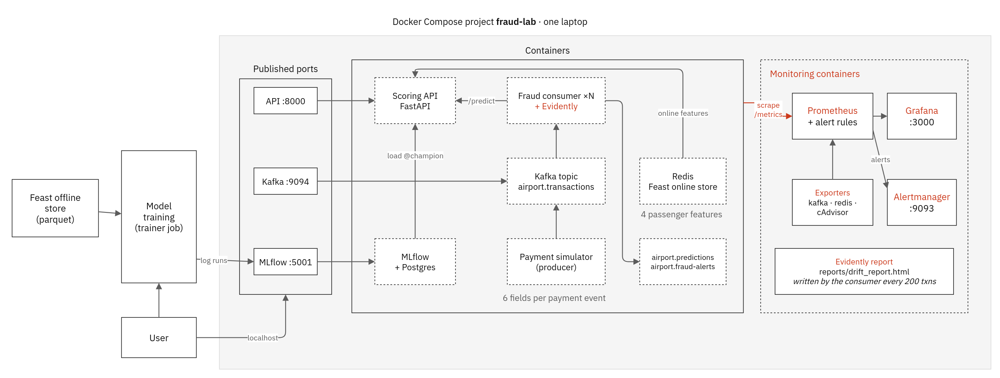
*Monitoring: Prometheus scrapes app and infrastructure metrics, Evidently checks drift inside the consumer, and Grafana and Alertmanager act on them.*

Open **Grafana → Airport Real-Time Fraud Detection** (it is the home dashboard).

| Row | What it shows | Source |
|---|---|---|
| Business view | payments/s, fraud alerts/min, fraud rate, champion version, active scenario, firing alerts, alerts by merchant/airport | consumer, API, simulator |
| Model monitoring | share of drifted features, dataset drift, drift per feature, mean fraud probability | **Evidently**, run in the consumer every 200 payments |
| Serving & streaming | API p95 (total / Feast / model), end-to-end latency, **Kafka consumer lag**, per-replica throughput | API, consumer, kafka-exporter |
| Infrastructure | container CPU and memory, Redis ops | cAdvisor, redis-exporter |

Prometheus alert rules (`monitoring/prometheus/alerts.yml`, see http://localhost:9090/alerts):
`FraudApiDown`, `FraudRateHigh`, `DataDriftDetected`, `KafkaConsumerLagHigh`.

### Live demo scenarios

```bash
make scenario-drift    # holiday season: 2.2× bigger baskets, more foreign travellers, night flights
make scenario-attack   # card-testing ring: the fraud rate jumps
make scenario-normal   # back to normal
make drift-report      # open the full Evidently HTML report (reports/drift_report.html)
```

1. **Data drift:** switch to `drift`. Within about 1–2 drift windows, *Dataset drift* turns **DRIFT** and
   the per-feature panel shows `amount`, `hour_of_day`, `is_international`, `minutes_to_departure`.
   The `DataDriftDetected` alert fires. Discuss: the model is not necessarily wrong, but its inputs no
   longer look like its training data → investigate, then retrain.
2. **Concept / business shift:** switch to `attack`. The fraud rate and alerts by merchant spike and
   `FraudRateHigh` fires. The mean-fraud-probability panel shows the **prediction drift**.
3. **Load:** `docker compose up -d --scale consumer=1` and raise `TRANSACTIONS_PER_SECOND` on the producer.
   Watch the **consumer lag** grow, then `make scale CONSUMERS=3` and watch it drain.

### Close the loop: retrain and redeploy

```bash
make train && make publish     # new champion only if it beats the current one
curl -s localhost:8000/model   # the API now serves the new version
```

Rollback: in MLflow, point `@champion` to the `@previous` version, then `curl -X POST localhost:8000/reload`.

---

## Step 9 — Automate (Prefect + Alertmanager) and the live lab console

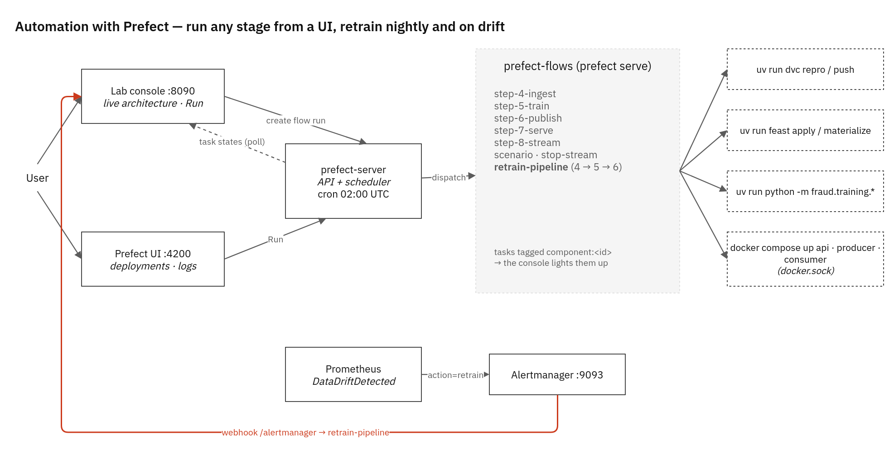
*Automation: Prefect runs every stage from a UI and retrains nightly, and an Alertmanager webhook triggers retraining on drift.*

```bash
make automate   # prefect-server (UI :4200), prefect-flows, Alertmanager (:9093), lab console (:8090)
make console    # opens http://localhost:8090
```

| Container | Role |
|---|---|
| `prefect-server` | Prefect API + UI + scheduler. Every stage is a **deployment** with a **Run** button. |
| `prefect-flows` | Serves the flows in `src/fraud/orchestration/flows.py` and executes their runs. Tasks call the same `uv run dvc …`, `uv run feast …`, `uv run python -m fraud.training.*` and `docker compose up …` commands used in this README, and stream their output into the Prefect logs. It reaches the Docker socket to start the API and stream containers. |
| `alertmanager` | Receives Prometheus alerts and sends them all to the console webhook. |
| `lab-console` | **Live architecture view for the class.** Each Prefect task is tagged `component:<id>`, so a box **pulses blue while a stage works on it**, turns **green when the stage finishes**, and edges animate as data flows (blue = stage running, green = payments streaming, red = alert → retrain). Every stage has a **Run** button, and there are buttons to switch scenarios and stop the stream. |

| Deployment | What it runs |
|---|---|
| `step-4-ingest/lab` | `dvc repro` → `dvc push` → `feast apply` → `feast materialize` |
| `step-5-train/lab` | training (Feast point-in-time join → 3 models → MLflow) |
| `step-6-publish/lab` | quality gate → register → `@champion` → hot-reload the API (param `force`) |
| `step-7-serve/lab` | start the API container → wait for `@champion` → smoke test `/predict` |
| `step-8-stream/lab` | start the producer + N consumers (params `consumers`, `transactions_per_second`) → check that payments are being scored |
| `scenario/lab`, `stop-stream/lab` | switch the simulator to `normal` / `drift` / `attack`; stop the stream |
| `retrain-pipeline/lab` | ingest → train → publish as subflows. **Nightly at 02:00 UTC** and **on data drift** |

**Teaching flow:** project the lab console, press **Run** on 4 → 5 → 6 → 7 → 8 one at a time, and let
the class watch the components light up (Prefect UI shows the logs of each task). Then:

1. Click **drift**. After about 1–2 drift windows, Evidently turns red. About 30 s later, `DataDriftDetected`
   fires. Alertmanager calls `POST /alertmanager` on the console, which starts `retrain-pipeline`
   (`reason: alert: DataDriftDetected`). The red *drift → retrain* edge animates and the pipeline lights up.
2. Discuss the result. The **quality gate** in step 6 only promotes the new model if it beats the champion.
   The *data* is the same, so it usually keeps the champion. In production, the ingest step would pull fresh
   labelled data, and that is what makes retraining useful.
3. Guards: a stage cannot run twice at the same time (`concurrency_limit=1`), and auto-retrain has a
   cooldown (`RETRAIN_COOLDOWN_MINUTES`, 3 min in the lab). Set `AUTO_RETRAIN_ON_DRIFT=false` to only log the alert.

> Why Prefect? It's Python-native: a flow is a decorated function, it has a good local UI, and it runs
> in one extra container. Airflow, Dagster or Kubeflow Pipelines fill the same role in larger platforms.

## Diagrams and branded docs

All diagrams are editable **draw.io** files (open them in draw.io / diagrams.net or the VS Code draw.io extension):

- `docs/diagrams/*-archimate.drawio`: ArchiMate 3 views (layered + workflow)
- `docs/images/tutorial-*.drawio`: the tutorial diagrams, recreated from the reference project and adapted to this lab

Two brands live in `brand/`. **The Majlis of AI** (skill `brand-tmofai`) is the default: white sheet, black linework,
one redline focal element, IBM Plex. **Aurora** (skill `brand-aurora`) is the alternative: polar night, one
oxygen-557 signal per view, Bricolage Grotesque and Atkinson Hyperlegible.
Each brand folder holds the diagram palette (`brand.json`), the docs stylesheet, the Mermaid theme, the mark and the banner.

| Command | Result |
|---|---|
| `make diagrams` | Regenerates the README diagrams in the default brand and exports PNGs with headless draw.io |
| `make diagrams BRAND=aurora` | The same in Aurora (overwrites the README images) |
| `make docs` | Builds the HTML docs site in the default brand → `site/majlisofai/index.html` |
| `make docs BRAND=aurora` | Builds the site in Aurora → `site/aurora/index.html`; the README images stay as they are |
| `make docs-all` | Builds the site in every brand |
| `make docs-open BRAND=aurora` | Opens a built site |

`make docs` renders the diagrams in the chosen brand into `build/<brand>/`, converts the README and
`docs/*.md` to HTML and themes the Mermaid diagrams. The first run fetches the brand fonts (OFL, from Google Fonts)
into `build/fonts/`, because the headless draw.io exporter cannot load web fonts. `build/` and `site/` are git-ignored.

---

## Cleanup

```bash
make down    # stop (keeps volumes: MLflow runs, Kafka data, Grafana)
make clean   # stop and delete volumes and generated data
```

## Next steps (homework)

1. CI/CD: GitHub Actions running `dvc repro`, `train`, `publish` with the quality gate.
2. Automated retraining triggered by the `DataDriftDetected` alert (Alertmanager webhook).
3. Streaming features: update Feast from Kafka with a push source (velocity features such as *payments in the last 10 minutes*).
4. Delayed labels: join chargebacks back to `airport.predictions` to monitor real precision and recall.
5. Move to Kubernetes: see the mapping table in [docs/01-architecture.md](docs/01-architecture.md).
