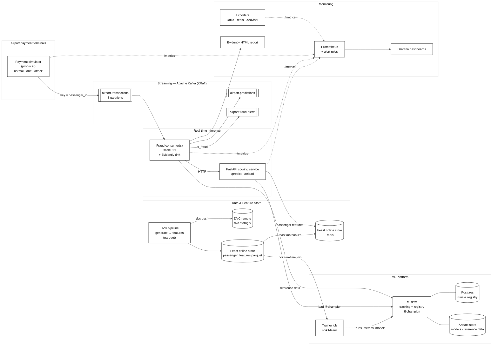

# Step 1 — High-Level Architecture

Real-time fraud detection for **card payments at airports** (duty free, currency
exchange, airline tickets, lounges, car rental…). Everything runs on one laptop
as Docker containers orchestrated by Docker Compose — no Kubernetes.

## Components

| Layer | Container(s) | Role | Port |
|---|---|---|---|
| Streaming | `kafka`, `kafka-init`, `kafka-ui` | Event backbone (KRaft, no ZooKeeper); topics created with 3 partitions | 9094, UI 8080 |
| Feature store | `redis` + Feast (library) | Offline store = parquet (training) · online store = Redis (serving) | 6379 |
| Data versioning | DVC (in `trainer`) | Reproducible data pipeline, parquet versioned in `dvc-storage/` | — |
| Model management | `mlflow`, `postgres` | Experiment tracking, model registry, artifact serving | 5001 |
| Training jobs | `trainer` (profile `jobs`) | DVC / Feast / training / publishing, run on demand | — |
| Serving | `api` | FastAPI: Feast enrichment + champion model, hot reload | 8000 |
| Real-time | `producer`, `consumer` ×N | Simulator → Kafka → scoring → predictions/alerts topics | — |
| Monitoring | `prometheus`, `grafana`, `kafka-exporter`, `redis-exporter`, `cadvisor` | Infra + app + model metrics, dashboards, alert rules | 9090, 3000, 8081 |
| Automation (step 9) | `prefect-server`, `prefect-flows`, `alertmanager`, `lab-console` | Run each stage from a UI, nightly + drift-triggered retraining, live architecture view | 4200, 9093, 8090 |

## The airport analogy (for the class)

Think of the system as an **airport security checkpoint** for money:

| Airport | System |
|---|---|
| Passengers arriving at security, one queue per lane | Payments arriving on **Kafka** partitions (one passenger always uses the same lane = message key) |
| The traveller's file with past trips | **Feast** passenger profile: 30-day spend, trips in 7 days, airports visited |
| The archive room vs. the officer's screen | **Offline store** (parquet, full history) vs. **online store** (Redis, latest value, sub-millisecond) |
| The security manual, with versions and an approved edition | **MLflow** registry; `@champion` = the edition officers must use |
| The security officer | **FastAPI** scoring service |
| The supervisor dispatching travellers to officers | **Consumer group**: add officers (`make scale`) and Kafka redistributes the lanes |
| The control room with CCTV and counters | **Prometheus + Grafana** |
| The auditor checking whether today's travellers still look like the ones in the manual | **Evidently** data drift |

## Why no Kubernetes?

Docker Compose gives us everything needed to *learn* the architecture on a laptop:
service discovery by DNS name, health checks, dependency ordering, profiles,
and horizontal scaling (`docker compose up --scale consumer=3`). Mapping to Kubernetes later
is mechanical:

| Docker Compose | Kubernetes |
|---|---|
| service | Deployment + Service |
| `--scale consumer=3` | `replicas: 3` / HPA (KEDA on Kafka lag) |
| `healthcheck` | readiness / liveness probes |
| named volume | PersistentVolumeClaim |
| `profiles: [jobs]` + `docker compose run trainer` | Job / CronJob (or Argo / Kubeflow pipeline) |
| Prometheus `dns_sd_configs` | Prometheus Operator `ServiceMonitor` |
