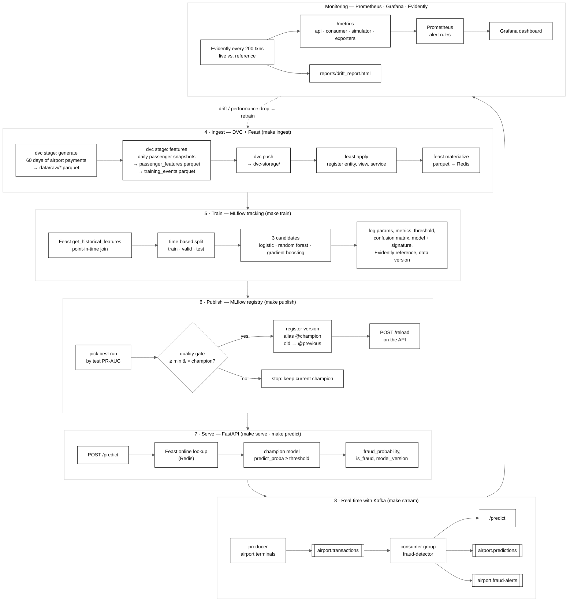
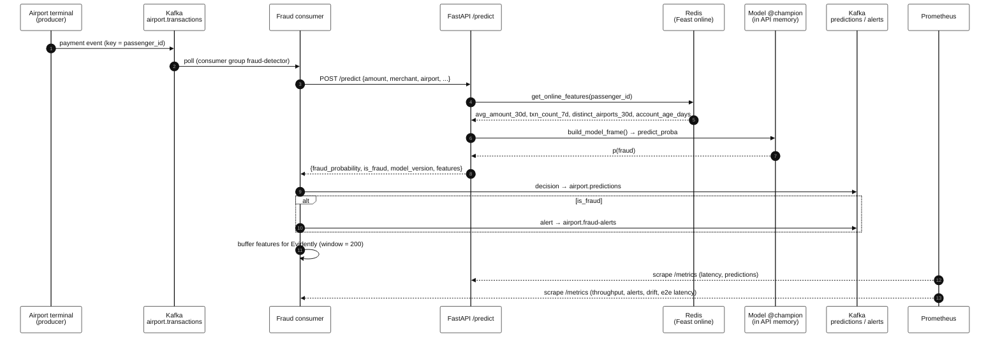

# Step 2 — Workflow: from Data Ingestion to Model Serving and Monitoring

> Also available as an editable ArchiMate view: [diagrams/02-workflow-archimate.drawio](diagrams/02-workflow-archimate.drawio) ([PNG](diagrams/02-workflow-archimate.png)).

## End-to-end flow

## Real-time path of one payment

## Lifecycle of a model (what changes when)

| Event | What runs | Result |
|---|---|---|
| New data / params changed | `make ingest` | new `dvc.lock` → commit = new **data version**; Redis refreshed |
| Code or data changed | `make train` | new MLflow runs tagged with `data_version` + `git_commit` |
| Better run available | `make publish` | new registry version → `@champion`; API hot-reloads, no downtime |
| Bad release | set `@champion` back to the `@previous` version in MLflow UI, then `curl -X POST localhost:8000/reload` | rollback in seconds |
| Drift detected (Grafana / alert) | inspect `reports/drift_report.html` → retrain on fresh data | closes the MLOps loop |
